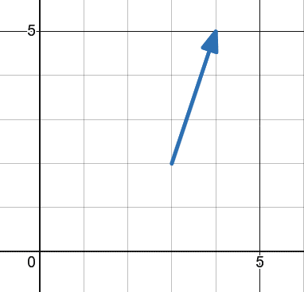
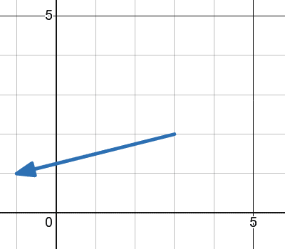
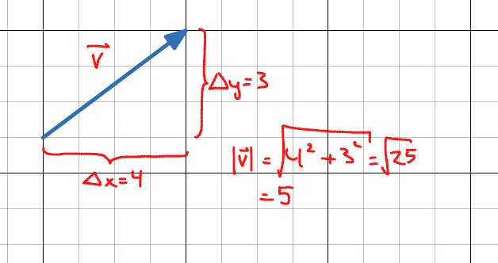
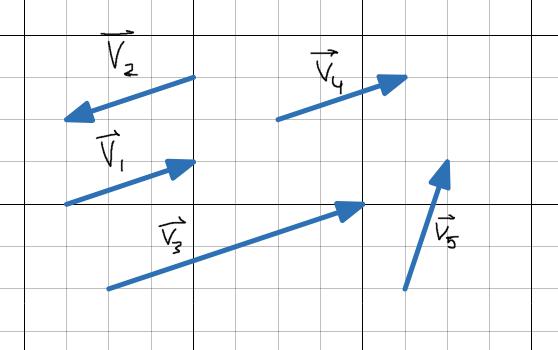
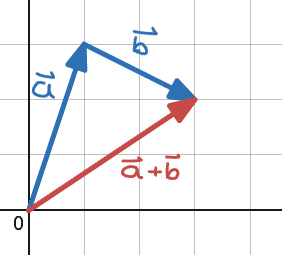
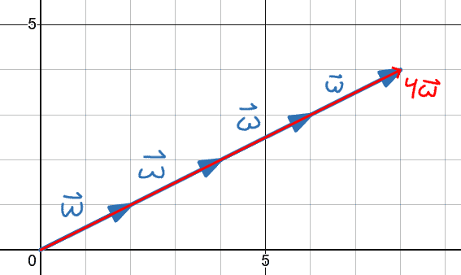
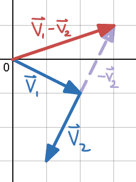

# Vektorer: en introduktion
### Mål
- Förstå skillnaden på en vektor och en punkt
- Kunna beräkna längden på en vektor
- Avgöra om två vektorer är lika långa
- Avgöra om två vektorer är parallella
- Förstå motsatsvektorer

### Agenda
1. Vad är en vektor?
2. Vektor mellan två punkter
3. Vektorns längd
4. Parallell vektor, motsatsvektor
5. Kombinera vektorer

### Introduktion
Vad är skillnaden mellan fart och hastighet?
Fart är hur fort du rör dig.
Hastighet har **också** en riktning. Det är därför en **vektor**.
En vektor är alltså en riktning med storlek, eller längd, allt i ett.

Detta fungerar som en introduktion på en av de första sakerna ni lär er i fysiken i vår: krafter.

### Notation

Vi skriver vektorer som $\vec{v}$ eller $\textbf{v}$, men vi använder pilnotation.

På *koordinatform* skriver vi $\vec{v}=(x_v,y_v)$.

> Vad är skillnaden på punkten $P=(1,4)$ och vektorn $\vec{v}=(1,4)$?
> - En punkt bara är. Det är en position i rymden, eller på pappret, relativt en nollpunkt (origo).
> - En vektor, å andra sidan, beskriver en *instruktion* eller *förflyttning*. Typ $\vec{v}=(1,4)$ betyder "ta ett steg höger, och fyra steg upp". Den har en längd och en riktning. 

### Vektor mellan två punkter
$$\text{Givet två punkter } A=(x_1,y_1) \text{ och } B=(x_2,y_2)$$
Då är vektorn mellan A och B
$$\vec{AB}=(x_2-x_1, y_2-y_1) = (\Delta x, \Delta y)$$

Låter svårt, men låt mig visa ett exempel:

Hur många steg tar den i $x$ respektive $y$?
$$\Delta x = 1, \Delta y = 3 \Rightarrow \vec{AB}=(1,3)$$

Ett till:

Hur många steg tar den i $x$ respektive $y$? $$\Delta x = -4, \Delta y = -1\Rightarrow \vec{AB}=(-4,-1)$$

### Vektorns längd
Vi sa innan att en vektor har en *riktning* och en *längd*, hur får man fram längd på en vektor i koordinatform?

För att ta fram en vektors längd placerar vi den i ett koordinatsystem. Längden blir då $c$ enligt Pythagoras sats.

$$c^2=a^2+b^2\quad \Rightarrow \quad c=\sqrt{a^2+b^2}$$ $$\vec{v} = (a,b)$$ $$|\vec{v}|=\sqrt{a^2+b^2}$$

### Andra begrepp kring vektorer
5 vektorerexemplet i boken s261:

Kommer ni ihåg linjers lutning?
Jag ser likadant på vektorer.
$$\text{Samma lutning} \Rightarrow \text{Parallella}$$

*OBS: Det här är **inte** en strikt matematisk definition, ty vi inte kan ha "oändlig" lutning upp eller ner.*

> Är $\vec{v_1} = \vec{v_4}$?
Ja, eftersom det inte spelar någon roll vart vi börjar rita vektorn från. De är samma eftersom de har samma längd, och samma riktning.

> Notera att $\vec{v_2}$ är samma som $\vec{v_1}$, förutom att den går i exakt motsatt riktning. De är *motsatsvektorer*! Det går att skriva som $\vec{v_2} = -\vec{v_1}$ eller $\vec{v_1} = -\vec{v_2}$

### Att kombinera vektorer
**Detta kommer vara det centrala innehållet på nästa lektion, så hänger du med här så är du helt redo inför fredag**.

*Resultanten* är resultatet på en kombination av vektorer.
$$\vec{a} + \vec{b}$$ $$\vec{w} + \vec{w} + \vec{w} + \vec{w} =4\vec{w}$$ $$\vec{v_1} - \vec{v_2}$$

Hur vet vi hur resultanten ser ut?
Eftersom vi betraktar vektorer som förflyttning, så kan man se det som att vi **följer varje vektor i uttrycket**:

#### Vektoraddition: $\vec{a} + \vec{b}$
Vi går först längs $\vec{a}$, sedan längs $\vec{b}$. Då har vi hamnat på $(\vec{a} + \vec{b})$

> Kika gärna på [Desmosaktivitet](https://www.desmos.com/geometry/ipnbqh4jml)

#### Multuplikation med skalär: $4\vec{w}$

#### Vektorsubtraktion: $\vec{v_1} - \vec{v_2}$
Här skriver vi om det som addition med en motsatsvektor såhär:
$$\vec{v_1} - \vec{v_2} = \vec{v_1} + (-\vec{v_2})$$

### Räkna
s.262-263
s.266-267

### Exit ticket
Svara enskilt. Räck upp handen om du är klar.
$$\vec{a}=(2,3) \quad \vec{b}=(2,-1) \quad \text{vad blir }|\vec{a}-\vec{b}|?$$