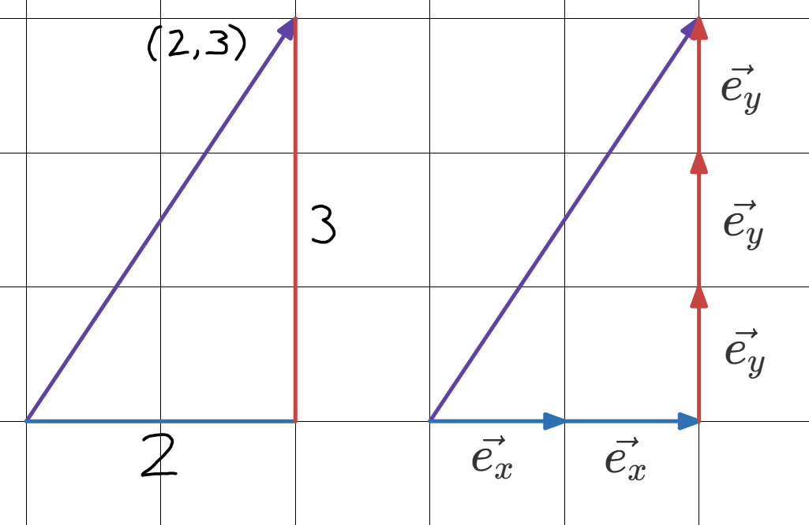
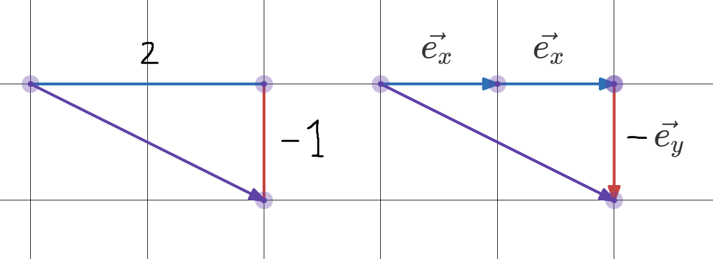

# Vektorer fortsättning
### Mål
- Förstå komposantuppdelning
- Kunna räkna med vektorer (kombinera algebraiskt)

### Agenda
1. Komposantindelning med enhetsvektorer
2. Härledning av $(+,-,\cdot)$
3. Koppla till trigibinetru

### Inledande fråga
> Teacher's note: Mittersta tavlan

> Om vi har två vektorer
> $\vec{a}=(1,2) \quad \vec{b}=(3,4)$
> Varför blir $\vec{a} + \vec{b}=(4,6)$?

> Teacher's note: EPA. **Enskilt**, **par**, **alla**.

För vissa kan det kännas självklart, men i matematiken ska vi vara försiktiga med att övergeneralisera. Vi måste kunna tänka oss hur vi kan bryta ner och motivera även de mest självklara sakerna på ett övertygande sätt.

Ett exempel från gårdagens exit ticket så skulle ni beräkna $|\vec{a}+\vec{b}|$. Jag såg några som övergeneraliserade och trodde att det var samma sak som $|\vec{a}|+|\vec{b}|$, men:
$$|\vec{a}+\vec{b}|\neq|\vec{a}|+|\vec{b}|$$

### Komposantindelning
Därför ska vi nu formalisera tre räkneregler för vektorer.

Jag visade er hur man skriver en vektor på koordinatform som $\vec{v}=(\Delta x, \Delta y)$ Men vad betydde egentligen detta? $\Delta x$ är *steg* i sidled. Men, vad är egentligen ett *steg*?

Ett sätt att se på ett steg är som en liten vektor med längden 1 som rör sig i *positiv* riktning: en *enhetsvektor* 

> Teacher's note: Dela upp första tavlan i två. Första halvan

Vi delar upp två vektorer och sådana steg och ser hur det blir. Första vektorn:

$$\text{Koordinatform:} \quad (2,3) $$

$$\text{Komposantform:} \quad 2\vec{e_x}+3\vec{e_y}$$

> Teacher's note: andra halvan av första tavlan

Andra vektorn:

$$\text{Koordinatform:} \quad (2,-1) $$

$$\text{Komposantform:} \quad 2\vec{e_x}-\vec{e_y}$$

#### Addition
> Teacher's note: mittersta tavlan

Med komposantform kan vi räkna på vektorer utan att rita upp dem. Addition med de två vektorer vi precis definierat:
$$(2,3)+(2,-1) = \{\text{komposantform}\} = (2\vec{e_x}+3\vec{e_y}) + (2\vec{e_x}-\vec{e_y}) \\ = 4\vec{e_x}+2\vec{e_y} = \{\text{koordinatform}\} = (4,2)$$

Vad är det vi faktiskt gjorde? Vi adderade bara vektorernas $\Delta x$, sedan vectorernas $\Delta y$
$$(2,3)+(2,-1) = (2+2,3+(-1)) = (4,2)$$

> Teacher's note: längst till höger

$$\text{alltså: } \quad (a,b) + (c,d) = (a+c, b+d)$$

#### Subtraktion
> Teacher's note: mittersta tavlan

Vi kan härleda subtraktion genom addition med motsatsvektor:
$$\text{Vanlig: }\big(2,-1\big) \quad \text{Motsats: } -\big(2,-1\big)=\big(-2,1\big)$$

$$\big(2,3\big)-\big(2,-1\big) = \big(2,3\big)+\big(-2,1\big) = \big(2+(-2),3+1\big) = \big(4,2\big)$$

> Teacher's note: längst till höger

$$\text{alltså: } \quad (a,b) - (c,d) = (a-c,b-d)$$

#### Multiplikation
> Teacher's note: mittersta tavlan

Multiplikation kan också härledas med addition.
$$3(2,3) = (2,3) + (2,3) + (2,3) = (2+2+2,3+3+3) = (3\cdot2, 3\cdot3) = (6,12)$$
> Teacher's note: längst till höger

$$\text{alltså: } \quad k(a,b) = (k\cdot a, k\cdot b)$$

### Räkna
s.269-270
Vill ni ha extra utmaning så vill jag att ni dyker djupare in på temauppgifterna 271-273. Bra förberedelse inför fysiken i vår.

Vi avbryter 10 minuter tidigare för en exit ticket.

### Exit ticket
> Inga miniräknare.
> $$\vec{a} = (187,277) \quad \quad \vec{b} = (12,21) \quad \quad k=10$$ Skriv resultanten $\vec{a} -k\vec{b}$ på koordinatform.
> Vi gör likadant som igår: räkna enskilt, och räck upp handen så stämmer jag av.