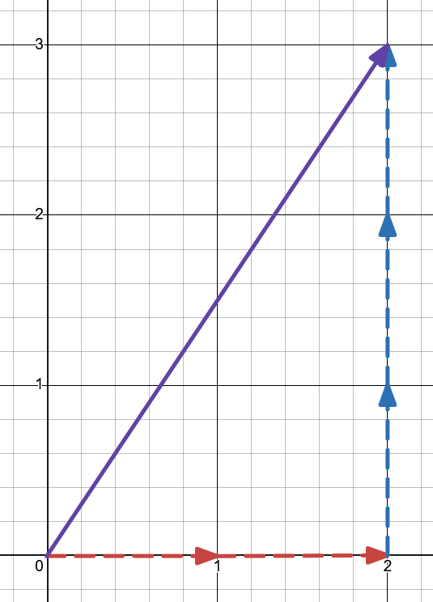

Mål:
- Räkna med vektorer
- Dela upp i komposanter
- Förstå krafter

Repetition

Komposanter:

(delat upp en vektor i små små enhetsvektorer)
> Hur många $\vec{e_x}$ och $\vec{e_y}$?
> Skriv ett uttryck för resultanten.

Fysikexempel: kombinera trigonometri med fysik