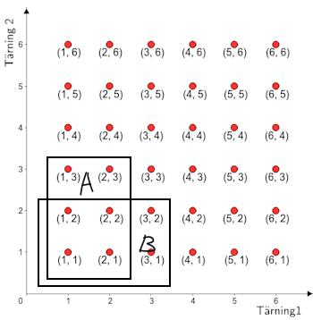
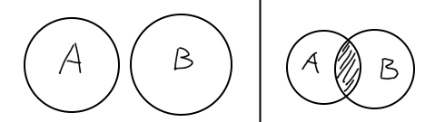
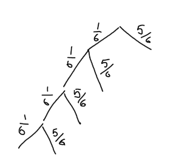
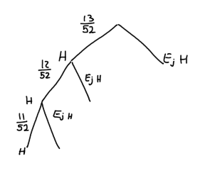

# Sannolikhet repetition
s.284-292
8:05-9:45

> Note: jag har uppfattat det som att ni har bra koll på sannolikhet, så jag testar att visa saker på ett mer matematiskt sätt, likt så det görs på högskolan.

## Agenda
1. Klassisk sannolikhet
2. Relativ frekvens
3. Slumpförsök i flera steg
4. Beroende och oberoende händelser
5. Exit ticket

## Uppvärmning
> Vad är den **horisontella kraftkomposanten** när jag drar en pulka med kraften $100$ newton $30^\circ$ från marken?
> Metod: Rita upp triangel med hypotenusan $100$ och beräkna närliggande kateten som
> $$\cos(30^\circ)=\frac{x}{100} \\ x=100\cdot\cos(30^\circ)=100\cdot \frac{1}{2}=50$$
>
> $\text{Svar: 50 N}$

## Klassisk sannolikhet & väntevärde
$$P(H)=\frac{\text{\# gynnsamma utfall}}{\text{\# totala möjliga utfall}}$$
Detta har ett namn: *klassisk sannolikhet*. Skriver vi om det får vi följande:

$$\text{\# gynnsamma utfall}=P(H)\cdot \text{\# totala möjliga utfall}$$ 

Detta kan man använda för att beräkna något som liknar "om vi kastar $6000$ tärningar, hur många kast kommer visa 1:a? Jo, $\frac{1}{6}\cdot 6000=1000$" Detta är ett slags *väntevärde*, eller förväntat tal.

## Relativ frekvens
$$f_R(H)=\frac{\text{\# gynnsamma observationer}}{\text{\# totalt antal observationer}}$$
> Vad skiljer Klassisk sannolikhet och Relativ frekvens?
> Det handlar om experiment och observationer.

**Visa programmeringsdemot, där för stora N leder till att** $f_R(H)\rightarrow P(H)$

Givet väldigt många observationer så kan $f_R$ användas för att uppskatta sannolikhet. Den relativa frekvensen blir då en så kallad *empirisk sannolikhet*.
$$f_R(H) = P_E(H) \approx P(H)$$

Den första likheten gäller endast om det är tillräckligt många observationer.

Tänk tärningskast. Vi kastar fyra gånger och får 6:a två gånger. $f_R(\text{6:a})=\frac{2}{4}=\frac{1}{2}$. Men vi vet ju att $P(\text{6:a})=\frac{1}{6}$

## Slumpförsök i flera steg
> När man räknar slump i flera steg, när använder man addition och när använder man multiplikation?

När "$P(A\text{ eller }B)$" eller "$P(A\text{ och }B)$" dyker upp i uppgifter gäller i allmänhet
$$P(A\text{ eller }B)=P(A) + P(B) \\ P(A\text{ och }B)=P(A) \cdot P(B)$$

(Kan illustreras med två tärningskast)

> Stämmer följande alltid?
> $$P(A\text{ eller }B)=P(A) + P(B)$$
>
> Nej, eftersom:
>
>
>
> I mängdbilden stämmer likheten

## Oberoende/beroende händelser
Två tärningskast är *oberoende*. 
> Vad betyder det?

Två händelser är oberoende om deras utfall inte påverkar varandras sannolikhet.

> Exempel: Sannolikhet att få dubbla sexor på två tärningskast.
> När man kastar den andra tärningen, så spelar det ingen roll alls vad första tärningen visade.
> $$\begin{aligned}P(T_1 = 4\text{ och } T_2 = 4) &= P(\text{tärning visar 4}) \cdot P(\text{tärning visar 4}) \\ &= \frac{1}{6} \cdot \frac{1}{6}\end{aligned}$$

Jämför detta med något vi sett tidigare: påsen med olika färgade bollar *utan återläggning*. Om man tar två bollar så *beror det andra draget på* vad man drar första gången.

En påse med 6 röda och 5 blåa. Sannolikheten att dra en blå på andra draget beror på vad du drog först.
$$P(\text{Nästa är blå } | \text{ Första var blå})=\frac{4}{10}=40\%$$

$$P(\text{Nästa är blå } | \text{ Första var röd})=\frac{5}{10}=50\%$$

Multiplikationsprincipen gäller som alltid, men den förändras en aning om händelserna är beroende.

Om $A$ och $B$ *oberoende*:
$$P(A \text{ och }B)=P(A)\cdot P(B)$$ 

Om $A$ och $B$ är *beroende*:
$$P(A \text{ och }B)=P(A)\cdot P(B|A)$$

(detta är faktiskt definitionen för betingad sannolikhet)

> Exempel 1:
> Vad är sannolikheten att få 6 på en sex-sidig tärning 4 gånger i rad?
> $\text{Lösning:}$
> 
> Eftersom vi vet att tärningskast är *oberoende* händelser så kan vi använda multiplikationsprincipen.
> $$\begin{aligned}P(\text{6 \text{och} 6 \text{och} 6 \text{och} 6}) &= P(\text{6}) \cdot P(\text{6}) \cdot P(\text{6}) \cdot P(\text{6}) \\ &=\frac{1}{6}\cdot \frac{1}{6}\cdot \frac{1}{6}\cdot \frac{1}{6}=\frac{1}{1296}\end{aligned}$$

***
> Exempel 2:
> Vad är sannolikhetheten att dra tre hjärter på rad från en ny kortlek som är blandad?
>
> $\text{Lösning:}$
> $\frac{1}{4}$ av alla kort är hjärter, alltså $\frac{52}{4}=13$.
> Beskriver händelsen en *beroende* eller *oberoende* händelse?
> Vi får då
> $$\begin{aligned}P(\text{H \& H \& H})&=P(\text{H})\cdot P(\text{H}|\text{H})\cdot P(\text{H}|\text{2H})\\&=\frac{13}{52}\cdot \frac{12}{51}\cdot \frac{11}{50} = \frac{11}{850}\end{aligned}$$

## Uppgifter
Fortsätt där ni slutade igår. Nya uppgifter på beroende händelser på sida 299.

## Exit ticket
Vad är sannolikheten att dra två kungar i rad från en hel blandad kortlek? Svara i procent, lämna in lapp till mig innan ni går (med namn).

$4 \text{ kungar} \Rightarrow P(\text{K och K})=\frac{4}{52}\cdot\frac{3}{51}=\frac{1}{221}=0.0045=0.45\%$