# Lån, ränta, amortering
**Sidorna:** 307-315
**Tid:** 9:45-11:20

Sidorna omfattar:
- Lån, ränta, amortering
- Introduktion till kalkylprogram
- Lån, ränta, amortering, i kalkylprogram

## Inledande aktivitet: responsiv undervisning:
Se [handout](/LP2_HT26/Lektionsplanering/Nivå%201c/261125%20Lån,%20ränta,%20amortering/Responsiv%20undervisning.md).

## Nya ordningsregler
Fredagslektionen var *stökig*. Jag är inspirerad av er kära lärare Jonatan. Ser jag någon spela, så har hen säkert spelat ett bra tag. Så jag skriver upp den personen på en lista, och den får 10 minuter frånvaro för varje regelbrott. Påminn mig om raster.

## Viktiga begrepp
Hur fungerar ett lån? Jo, vi får en summa pengar direkt och ska sedan betala av det varje månad över en period. Summan man betalar av varje månad kallas för **amortering**.

**Men får man bara massa pengar direkt och sedan betalar tillbaka det över tid?** Njaa, liksom allt annat som låter för bra för att vara sant så finns det en hake: **ett lån kostar pengar**.

Säg att du tar ett lån på en miljon kronor så kommer du till slut betalat tillbaka mer än lånebeloppet. Kostnaden för ett lån kallas för **ränta**.

> ___________________
> ##### Begreppslista:
> 
> *Lånebelopp* - Summan pengar man lånar. Tar man lån så är man *låntagare*.
> 
> *Amortering* - Den summa av lånet man betalar av per månad. Lånebeloppet minskar vid amortering. Ifall vi har rak amortering:
> $\text{Amortering}=\frac{\text{Lånebelopp i början}}{\text{Avbetalningsperiod}}$
> 
> *Räntesats* - den procent av lånet du ska betala tillbaka varje månad. Ibland visas *årsräntan*, och då beräknar vi räntesatsen som:
> $\text{Räntesats}=\frac{\text{Årsränta}}{12}$
> 
> *Ränta* - Ränta är månadskostnad för lånet.
> $\text{Ränta}=\text{Lånebelopp} \cdot \text{Räntesatsen}$
> ___________________

OBS: om lånebeloppet minskas såsom 
vid amortering, så minskar också räntan. Ett lån är alltså dyrare i början än i slutet av avbetalningsperioden.

#### Exempel
> Nils ska köpa motorcykel. Han tar lån på $80000 \text{ kr}$ med $24\%$ årsränta.
> $\text{a})$ Hur mycket betalar han i ränta första månaden? $2\% \Rightarrow 0.02\cdot 80000 = 1600$
> $\text{b})$ Hur mycket betalar han i ränta andra månaden? Samma! Lånebeloppet är oförändrat. 
> $\text{c})$ Om Nils amorterar $2000 \text{ kr}$ per månad, hur mycket betalar han totalt in till banken den tredje månaden?
> |Månad|Lånebelopp|Ränta|Amortering|Att betala|
> |-----|----------|-----|----------|----------|
> |$1$|$80000$|$1600$|$2000$|$3600$|
> |$2$|$78000$|$0.02\cdot78000=1560$|$2000$|$3560$|
> |$3$|$76000$|$0.02\cdot76000=1520$|$2000$|$3520$|

Hur går vi till väga om vi vill beräkna kostnaden för lånet? Kostnaden är hur mycket man totalt betalat i ränta under avbetalningsperioden. Det blir många upprepande beräkningar

## Intro till kalkylprogram

Hur mycket kostar lånet för Nils, totalt över hela avbetalningsperioden? Här kommer kalkylprogram fram.
##### 0. Terminologi
En ruta i ett kalkylark kallas för en cell. Cellen skrivs på ganska likt sätt som rutor i schack.
$\text{Cell B4}$ betyder *kolumn* B, *rad* 4.

##### 1. Öppna geogebras spreadsheet-läge (Geogebra Classic)

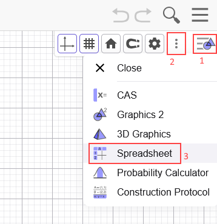
eller
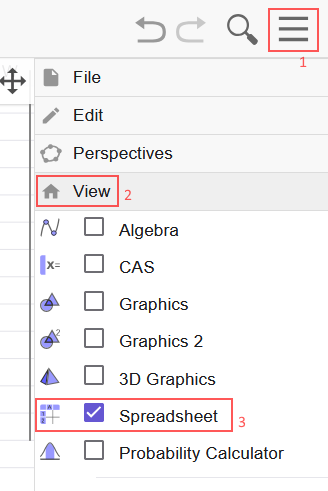

##### 2. Fyll i rubriker
Om vi skriver månad 1 och 2 i cellerna A2 och A3 såkan vi välja dem båda (drag med vänster musknapp över cellerna) och sedan greppa kvadraten i nedre högra hörnet för att dra ut och få många fler månader automatiskt.
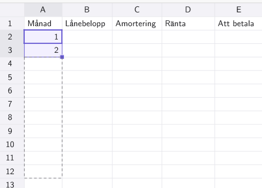

##### 3. Fyll ut våra startvärden
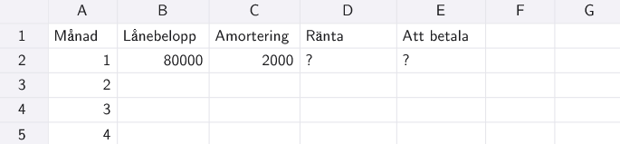

##### 4. Skriv *formeln* för lånebelopp månad 2
Förra månadens lånebelopp minus amorteringen är det nya lånebeloppet. Det kan man skriva som en formel på detta sättet:
"Det som ligger på B2 minus det som ligger på C2".
"$=\text{B2}-\text{C2}$"
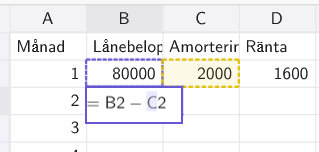

##### 5. "Drag ut" amorteringen och sedan lånebeloppet
Vi väljer endast en cell denna gången, inte två, då vi vill kopiera precis den formeln vi skrivit in för den andra månaden.
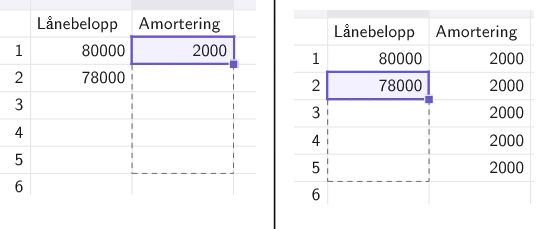

##### 6. Skriv *formeln* för räntan
Räntan kommer vi ihåg var $\text{Ränta}=\text{Lånebelopp} \cdot \text{Räntesatsen}$. Men lånebeloppet ändras varje månad. Vi kan istället skriva cellen där lånebeloppet ligger som följande:
$\text{Ränta}=\text{B2} \cdot \text{Räntesatsen}$
När man skriver i cellen blir det "$=\text{B2} * 0.02$". Det första "$=$" MÅSTE vara med, för annars tolkas det inte som en formel.
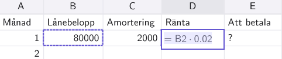

##### 7. Skriv *formeln* för återbetalningsbeloppet
Det vi betalar tillbaka är amorteringen och räntan tillsammans. Hur skriver vi en formel för det? "$=\text{C2}+\text{D2}$"
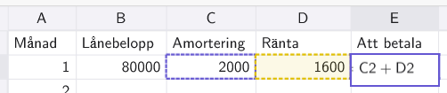

##### 8. "Drag ut" Ränta och Att betala.
Vi håller inne vänster musknapp, drar över båda cellerna, sedan drar ut kvadraten ner till höger.
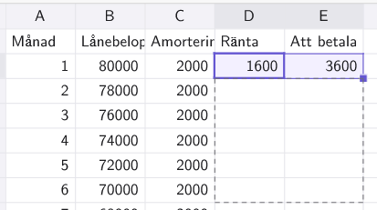

##### 9. "Drag ut" allt
Vi fortsätter att dra ner formlerna tills vi kommer ner till lånebeloppet noll.
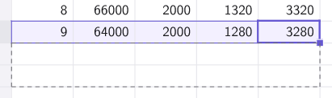
> Tips! Nils har betalat av lånet efter $\frac{80000}{2000}=40$ månader.

##### 10. Beräkna total kostnad
Lånets totala kostnad är summeringen av alla räntebetalningar.
Istället för "$=\text{D2} + \text{D3} + ... + \text{D41}$" så kan vi markera ett intervall med "$:$" och sedan använda funktionen *Sum*: "$=\text{Sum(D1:D41)}$"
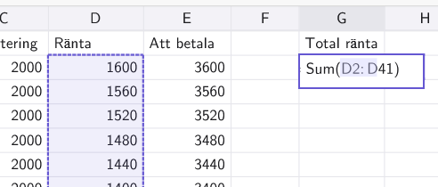

##### 11. Variabler
Vad händer om vi vill ändra räntesatsen? Istället för att ändra det manuellt så kan vi använda oss av en variabel. Låt oss skriva en ny räntesats på 3% i G4. Då kan vi använda G4 istället för 0.03, ifall vi ändrar oss i framtiden.
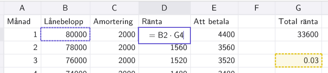

Om vi nu "drar ner" den nya formeln för räntan för alla månader, då kommer G4 flytta på sig. Därför måste vi modifiera formeln, och använda *dollartecken*. Vi berättar för kalkylprogrammet att varken kolumnen eller raden får flytta på sig.
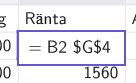
Nu kan vi dra ner hela vägen. Vad blir den totala kostnaden för lånet? Om du har gjort rätt, ska det bli 49200 kr! Väldigt mycket pengar! Det betyder att motorcykeln kostade totalt 129200 kr, hela $\frac{129200}{80000}=61.5\%$ mer pengar eftersom du tog lånet på 3% ränta över 40 månader!

## Rast yo
Trust.

## Uppgifter
s.309 Lån, ränta, amortering
s.311 Intro till kalkylprogram
s.314 Kräver Geogebra/Excell