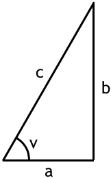

(Definitionsmängd för sin och cos är inte lika snälla som för tangens?)

Vi har redan sett $\tan(v)$. Det finns två andra kvotar att hålla reda på: $\sin(v)$ och $\cos(v)$

$$\tan(v)=\frac{b}{a} \quad \quad \quad \quad \cos(v)=\frac{b}{c} \quad \quad \quad \quad \sin(v)=\frac{a}{c}$$

$$v=\arctan\bigg(\frac{b}{a}\bigg) \quad \quad v=\arccos \bigg( \frac{b}{c}\bigg) \quad \quad v=\arcsin \bigg(\frac{a}{c}\bigg)$$

