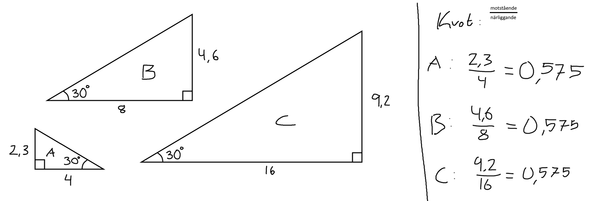
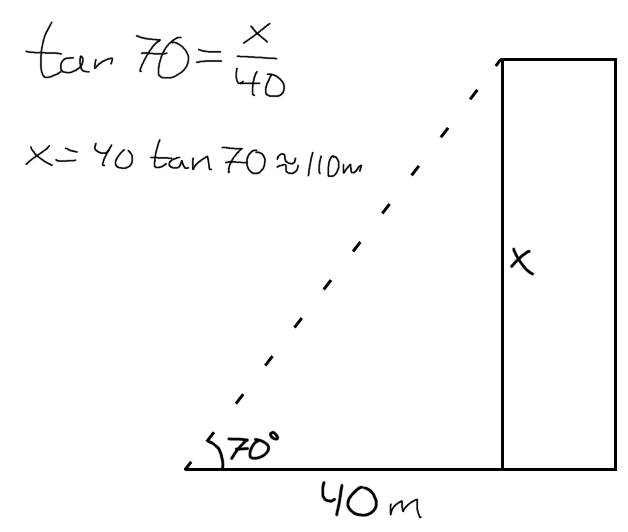
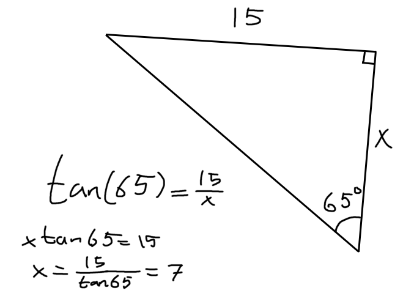
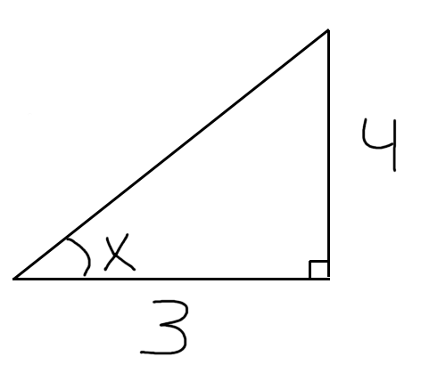
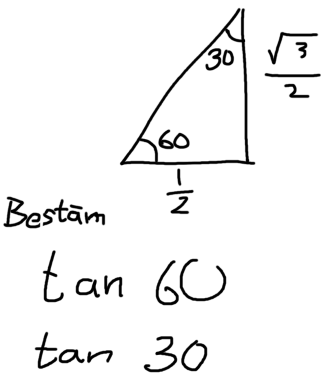

### Innehåll
1. Vad är trigonometri?
    - från grekiskans Trigono = triangel, Metron = mått
    - Tanken är att om du kan formen på en triangel, så vet du hur långa sidorna är i förhållande till varandra.
2. Det gäller: $\sin(), \cos(), \tan()$.
Idag ska vi kika på $\tan()$.

### Syfte
googoogaga

### Engage
Här har ni en uppgift.

> Du står på marken, 40 meter från ett torn. Du tittar upp mot toppen med en vinkel på 70 grader. **Hur högt är tornet?**

Rita en rät triangel med torn, sätt ut 40m och 60 grader.

### Explore (tillsammans)
Be eleverna beräkna kvoten åt dig.

> Slutsats: Förhållandet mellan kateterna är alltid samma, om vinkeln aldrig ändras.
Obs: det exakta värdet på kvoten blir $\frac{1}{\sqrt{3}}$

### Introducerar tangens (Explain)
Det är detta vi kallar för *tangens*. Förväxla **inte** detta med **tangent**.

$$\textbf{Def:} \quad \tan(v) := \frac{\text{Motstående katet}}{\text{Närliggande katet}}$$

$\tan(30^\circ)$ betyder alltså "kateternas förhållande för vinkeln $30^\circ$".
$\tan(45^\circ)$ "kateternas förhållande för vinkeln $45^\circ$".

**Notera:**
En triangel med vinkeln $45^\circ$ har vadå för kvot?
*Rita en kvadrat, med diagonal.*
Kateterna är lika långa! Förhållandet blir 1
$$\tan(45^\circ)=1$$

### Elaborate 1: Ekvationslösning
Vi återgår till tornet vi inledde lektionen med.

#### Uppgift tillsammans:
> Du står på marken, 40 meter från ett torn. Du tittar upp mot toppen med en vinkel på 70 grader. **Hur högt är tornet?**

#### En till uppgift tillsammans:

### Elaborate 2: Invers funktion: $\arctan()$
Kan vi beräkna vinkeln $v$ från längdförhållande?

$$\tan(x)=\frac{4}{3}$$

Jag ser det som en ekvation.
Vid ekvationslösning använder vi *motsatsoperationer*:
- $\times \quad \text{mot} \quad \div$
- $+ \quad \text{mot} \quad -$

Hur får vi $x$ när vi har tangens?
Motsatsoperationen för $\tan()$ är $\arctan()$. Ibland skrivs det med inversnotation: $\tan^{-1}()$. Man kallar det arcustangens.
$$\begin{aligned}
    \tan(x)&=\frac{4}{3} \\
    \arctan(\tan(x))&=\arctan(\frac{4}{3}) \\
    x&=\arctan(\frac{4}{3})
\end{aligned}$$

> Stryk arctan och tan, visa att det är som när man stryker *3 och /3

### Evaluate
Utan miniräknare: bestäm $\tan(60^\circ)$ och $\tan(30^\circ)$
