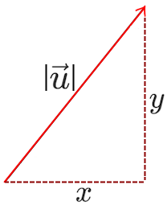
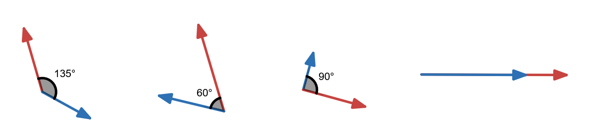
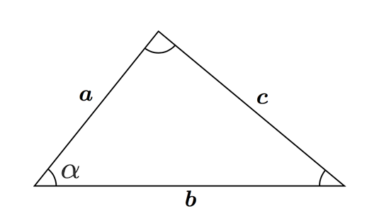
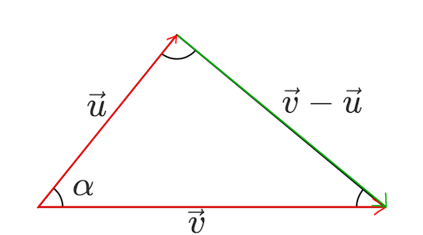

# Skalärprodukt
### 0. Syfte
Kort introduktion:
Jesper på tavlan.
Har tidigare undervisat i matematik 2b på ett litet gymnasie i Borås som heter Ljud- & Bildskolan. 145 elever.
Motorcyklar och datorspel.

Idag ska vi lära oss om skalärprodukt.
Varför skalärprodukt? I matten:
- Mäta vinkel mellan två vektorer
- Projektioner

I praktiken:
- Fysik "Ett filter":
    - Vindkraft och segling
    - Lutande plan
- Datorspel:
    - Field of View
    - Skuggor
    - Rasterisering
    - Backface culling

Upplägg idag:
1. Längden av en vektor
2. Skalärprodukt definition
3. Cosinussatsen
4. Cosinussatsen med vektorer
5. Ett exempel
6. Eget arbete

Ordningsregler:
Under genomgången: inga datorer eller telefoner. Är det tydligt att ni fotograferar *tavlan* så är det ok.
Jag uppmuntrar att ta anteckningar: till exempel viktiga formler.

### 1. Längden av en vektor. Förkunskap.
Längden beräknas genom att bygga en rätvinklig triangel av vektorns komposanter, och sedan beräkna hypotenusans längd.

### 2. Rakt på definition. EPA
$$\vec{u} \cdot \vec{v} := |\vec{u}||\vec{v}|\cos(\alpha)$$
#### Uppgift
Vad kan vi säga om skalärprodukten? Vad gäller för varje figur?
$$\vec{u} \cdot \vec{v} < 0 \quad \textbf{eller} \quad \vec{u} \cdot \vec{v} > 0 \quad \textbf{eller} \quad \vec{u} \cdot \vec{v} = 0$$

1. Enskilt
2. Diskutera med varandra
3. Allihopa

### 3. Vanlig triangel
Betrakta triangeln. Vi formulerar cosinussatsen:

$$c^2=a^2+b^2-2ab\cos(\alpha)$$
> Utgå från en vinkel $\alpha$. Dess sida, $c$, kan beräknas med de längderna som bildar vinkeln $\alpha$ enligt cosinussatsen.

### 4. Med vektorer
$a,b,c$ i förra triangeln är alla *sträckor*. Vi kan se det som längden av vektorerna som går längs varje $a,b,c$.

Låt $u$ och $v$ vara vektorerna som motsvarar $a$ och $b$. Vi skriver det som $\vec{u}$ och $\vec{v}$. Längden på vektorerna noterar vi med raka streck, som följande: $|\vec{u}|$ och $|\vec{v}|$.

$c$ kan skrivas om som $\vec{v} - \vec{u}$ enligt det vi lärde oss om vektorsubtraktion (se s. 213 för mer om räknelagar).

*(Från förra lektionens slut minus start)*
Med vektornotation, hur blir cosinussatsen?
$$\begin{aligned}
    c^2 &= a^2+b^2-2ab\cos(\alpha) \\
    |\vec{v} - \vec{u}|^2 &= |\vec{u}|^2 + |\vec{v}|^2-2|\vec{u}||\vec{v}|\cos(\alpha)&(1)
\end{aligned} $$

$(1)$ kan då skrivas om som
$$\begin{aligned}
    2|\vec{u}||\vec{v}|\cos(\alpha) &= |\vec{u}|^2 + |\vec{v}|^2 - |\vec{v} - \vec{u}|^2 \\
    2(\vec{u} \cdot \vec{v}) &= x_u^2+y_u^2 + x_v^2+y_v^2 - ((x_v - x_u)^2+(y_v-y_u)^2) \\
    &= x_u^2+y_u^2 + x_v^2+y_v^2 - (x_v - x_u)^2-(y_v-y_u)^2 \\
    &= x_u^2+y_u^2 + x_v^2+y_v^2 - (x_v^2 - 2x_vx_u + x_u^2)-(y_v^2-2y_vy_u+y_u^2) \\
    &=  - (- 2x_vx_u)-(-2y_vy_u) \\
    &=  2x_vx_u+2y_vy_u \\
\end{aligned} $$
Alltså
$$2(\vec{u} \cdot \vec{v}) = 2x_vx_u+2y_vy_u$$
$$\vec{u} \cdot \vec{v} = |\vec{u}||\vec{v}|\cos(\alpha) = x_vx_u + y_vy_u$$

### Exempel 5126:
Avgör om $\vec{u} = (4, -5)$ är vinkelrät mot $\vec{v}$, då
a\) $\vec{v} = (4,3)$
$\vec{u} \cdot \vec{v} = 4 \cdot 4 + (-5) \cdot 3 = 16 - 15 = 1 \Rightarrow \textbf{Ej vinkelrät}$ 

b\) $\vec{v} = (10,8)$
$\vec{u} \cdot \vec{v} = 4 \cdot 10 + (-5) \cdot 8 = 40 - 40 = 0\Rightarrow \textbf{Vinkelrät}$ 

> Vad betyder "vinkelrät"? 90 graders vinkel, alltså $\cos(\theta)=0\Rightarrow\vec{u} \cdot \vec{v}=0$

### Räkna själva
...på sida 221.

