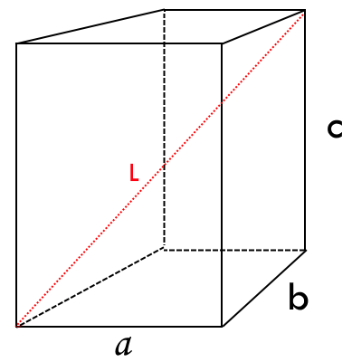
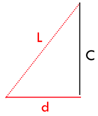
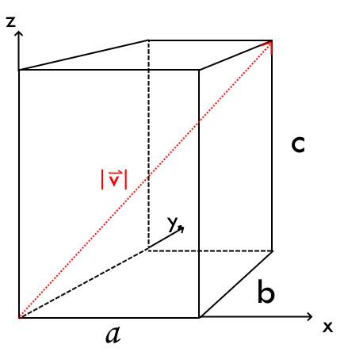

# Vektorer i rymden
## Syfte & mål
Gå från 2D till 3D.
Vi ska snart täcka både linjer OCH plan i rummet och då behöver vi använda tre dimensioner

## Agenda
1. Räknelagarna i tre dimensioner
2. Avståndsformeln
3. Skalärprodukt
4. Räkna själva

## Räknelagarna
Vi ska börja använda ny notation för vektorer.
$$\text{låt} \quad \vec{u} = \begin{bmatrix} a \\ b \\ c \end{bmatrix} \quad \vec{v} = \begin{bmatrix} x \\ y \\ z \end{bmatrix}$$
$$\vec{u} + \vec{v} = \begin{bmatrix} a \\ b \\ c \end{bmatrix} + \begin{bmatrix} x \\ y \\ z \end{bmatrix} = \begin{bmatrix} a+x \\ b+y \\ c+z \end{bmatrix}$$ 
$$\vec{u} - \vec{v} = \begin{bmatrix} a-x \\ b-y \\ c-z \end{bmatrix}$$  
$$\text{om k är en konstant} \\ k\vec{u} = k \begin{bmatrix} a \\ b \\ c \end{bmatrix} =\begin{bmatrix} ka \\ kb \\ kc \end{bmatrix}$$ 

## Avståndsformeln
### Uppgift EPA

> *Vad är längden på L, uttryckt i a,b,c?*

**Låt eleverna fundera. Sedan P. Sist A:**

Förenklar det sökta:

$$d=\sqrt{a^2+b^2}$$
Alltså blir
$$L=\sqrt{d^2+c^2}=\sqrt{a^2+b^2+c^2}$$

Nu ska vi tänka om med vektorer.
Rita in axlar och uttryck för vektorn:
$$\vec{v}=\begin{bmatrix} a \\ b \\ c \end{bmatrix}$$
(var extra tydlig att $a=x$, $b=y$, $c=z$)

$L$ är samma som $|\vec{v}|$
Detta är avståndsformeln i 3D.
$$|\vec{v}|=\sqrt{a^2+b^2+c^2}$$

## Skalärprodukten
Kom ihåg från igår:
$$\vec{u} \cdot \vec{v} = |\vec{u}||\vec{v}|\cos(\alpha) = a\cdot x + b\cdot y$$

> Vad händer när vi ändrar till tre dimensioner?

Mönstret upprepar sig, men spännande nog blir det endast "förenklingen" a definitionen som ändrar sig.
$$\vec{u} \cdot \vec{v} = |\vec{u}||\vec{v}|\cos(\alpha) = a\cdot x + b\cdot y + c\cdot z$$

## Räkna själv
s. 225 (5 uppgifter)
s. 227

## Exit ticket
Ge exempel på två *enhetsvektorer* i *3D* som är *orthogonala*.