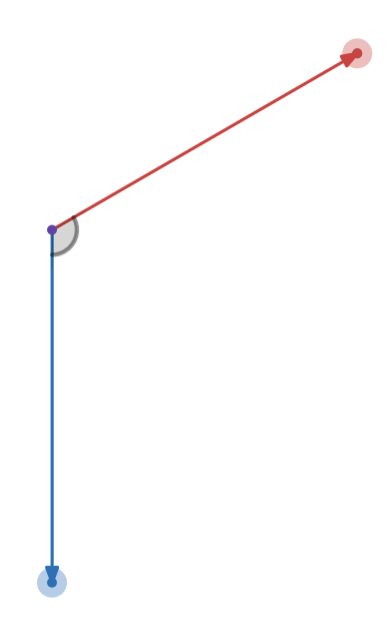
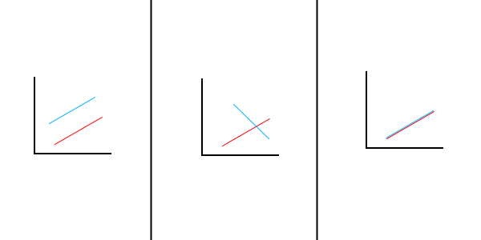
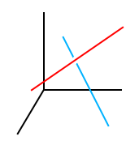

# Linjer i rymden
s.228

## Agenda
1. Entry ticket
2. Vektorform
3. Parameterform
4. Skärande linjer
5. Uppgifter
6. Exit ticket

## Entry ticket
> Vad är vinkeln mellan vektorerna
> $$\vec{a}=\begin{bmatrix}0\\-2\end{bmatrix} \quad \vec{b}=\begin{bmatrix}\sqrt{3}\\1\end{bmatrix}$$
> 
> ***
> Lösning:
> Skalärprodukt kan användas för att beräkna vinkel mellan två vektorer.
> $$\vec{a}\cdot \vec{b}=|\vec{a}||\vec{b}|\cos\theta \\
\frac{\vec{a}\cdot \vec{b}}{|\vec{a}||\vec{b}|}=\cos\theta$$
> Fortsätter...
> $$\vec{a}\cdot \vec{b}=0\cdot \sqrt3 + (-2)\cdot 1 = -2\\
|\vec{a}||\vec{b}| = \sqrt{\sqrt3^2+1^2} \sqrt{(-2)^2+\sqrt0^2}=2\cdot2 \\
\Rightarrow\cos\theta=\frac{-2}{4}=-\frac{1}{2}$$
> $\theta=120^\circ$. Kan motiveras med enhetscirkeln.
## Linjer
Vad är en linje?
[Desmos](https://www.desmos.com/3d/hstza6ckqr)

## Vektorform
Tänk er en riktningsvektor $\vec{r}$ som börjar i origo. Om vi multiplicerar med en parameter $t\in\mathbb{R}$ så har vi definierat *alla* punkter som ligger på linjen som pekar längs vektorn.
$$L(t)=t\vec{r}$$
> Exempel:
> $$L(t)=t\begin{bmatrix}\frac{1}{\sqrt{2}}\\\frac{1}{\sqrt{2}}\\0\end{bmatrix}$$

Problemet är att vi endast utgår från origo. Hur får vi en helt godtycklig linje? Vi utgår från föregående, fast vi adderar en förskjutning/"offset"/startpunkt $P_0$. Detta kallas för en linje på *vektorform*.
$$L(t)=P_0+t\vec{r}$$
> Exempel:
> $$L(t)=\begin{bmatrix}0\\1\\0\end{bmatrix}+t\begin{bmatrix}\frac{1}{\sqrt{2}}\\\frac{1}{\sqrt{2}}\\0\end{bmatrix}$$

## Parameterform

$L(t)$ betyder att för ett givet $t$ så får vi exakt en punkt $(x,y,z)$. Säg att $P_0$ har komponenterna $x_0$, $y_0$, $z_0$, och riktningsvektorn $\vec{r}$ har komponenterna $a$, $b$, $c$.
Då går linjens ekvation att skriva som
$$L(t)=\begin{bmatrix}x\\y\\z\end{bmatrix}=\begin{bmatrix}x_0\\y_0\\z_0\end{bmatrix}+t\begin{bmatrix}a\\b\\c\end{bmatrix}$$
Detta ger oss tre olika ekvationer, vilket vi kallar en linje på *parameterform*.
$\begin{cases}x=x_0+at\\y=y_0+bt\\z=z_0+ct\end{cases}$

> Elevaktivitet: spå tillsammans bordsvis/med grannen:
> Vad blir den tidigare linjen vi definierade på parameterform?
>
> Exempel, samma linje som innan:
> $$\begin{cases}x=\frac{1}{\sqrt2}t \\ y=1+\frac{1}{\sqrt2}t \\ z=0\end{cases}$$

## Skärande linjer
Vi ska undersöka skärande linjer.
Säg att vi har två linjer i 2D.
Hur många lösningsfall kan vi ha?
> I 2D gäller att tre fall kan uppstå:
> - En enda korsningspunkt
> - Oändligt många (parallella, samma linje)
> - Inga (parallella)

> I 3D finns det ett **ytterligare** fall:
> - **Skeva** linjer. Inga korsningspunkter, fast ej parallella linjer

Hur tar man fram en skärning algebraiskt?
Först undersöker vi om linjerna är parallella för att eleminera enkla lösningar. Sen sätter vi $L_1(t)=L_2(t)$ och löser för $t$. 
$$L_1(t)=\begin{cases}x=\frac{1}{\sqrt2}t \\ y=1+\frac{1}{\sqrt2}t \\ z=0\end{cases}$$

$$L_2(t)=\begin{cases}x=3t \\ y=1+t \\ z=t\end{cases}$$
> Vad är riktningsvektorerna?
> $$\vec{r_1} = (\frac{1}{\sqrt2},\frac{1}{\sqrt2},0)$$
>
> $$\vec{r_2} = (3,1,1)$$
>
> $$\text{Ej parallella.}$$

$$\begin{cases}\frac{1}{\sqrt2}t=3t \\ 1+\frac{1}{\sqrt2}t=1+t \\ 0=t\end{cases}$$

Vi får att $t=0$ stämmer för alla ekvationer.
$L_1(t)\Big|_{t=0}=L_2(t)\Big|_{t=0}=\begin{bmatrix}3\cdot0 \\ 1+0 \\ 0\end{bmatrix}=\begin{bmatrix}0 \\ 1 \\ 0\end{bmatrix}$

## Uppifter
s.229-231

## Exit ticket
Lämna in svar på lapp
> $$L_1(t)=\begin{cases}x=5+3t \\ y+5-\frac{1}{2}t=0 \\ 1-z=0\end{cases}$$
> $$L_2(t)=\begin{bmatrix}0\\2\\-\frac{1}{2}\end{bmatrix}t-\begin{bmatrix}1\\2\\0\end{bmatrix}$$
$a) \quad \text{Vad är riktningsvektorerna }\vec{r_1} \text{ och } \vec{r_2}$
$b) \quad \text{Skär linjerna varandra? Om ja, i vilken punkt?}$

            
            
$t=-2$
$(-1,-6,1)$