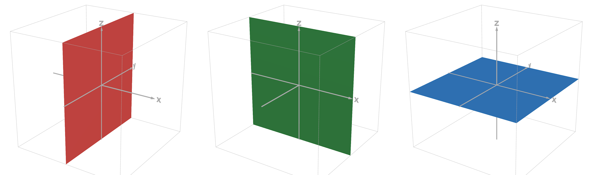

# Plan i rymden

## Agenda
1. Några speciella plan
2. Ett godtyckligt plan
3. Uppgifter

## Några speciella plan
I 2D kommer vi ihåg att ekvationerna för x- och y-axeln är
$$\text{x-axeln: } \quad y=0 \\ \text{y-axeln: } \quad x=0$$
Vill vi flytta till exempel x-axeln upp fyra steg, så har den ekvationen $y=4$.

För att definiera plan kan vi göra likadant. Ekvationer för alla tre basic plan:
$$\text{zy-planet: } \quad x=0 \\ \text{xz-planet: } \quad y=0 \\ \text{xy-planet: } \quad z=0 $$

Vi kan flytta planen precis som för enkla linjer, t.ex. $y=4$ är:

> Uppgift:
> Ange ekvationen för det plan $\pi$ som
> 1. passerar genom punkten $P=(2,4,3)$
> 2. är parallell med xy-planet.

## Det godtyckliga planet

Det smidigaste sättet att definiera ett plan är med dess normalvektor.

> Vad är en normalvektor? Kom ihåg från fysiken.

Om vi har ett plan med normalvektor $\vec{n}$ så vet vi att följande gäller:
- En **specifik** punkt där vi vill att planet ska utgå från är $P_0=(x_0,y_0,z_0)$
- En **godtycklig** punkt i planet är $P=(x,y,z)$
- Vektorn som leder från $P_0$ till $P$ skrivs enligt "slut-minus-start":
$$\vec{P_0P}=P-P_0=\begin{bmatrix}x-x_0 \\ y-y_0 \\ z-z_0\end{bmatrix}$$
- $\vec{n}$ och $\vec{P_0P}$ är **orthogonala**

Det betyder att förljande samband **måste** stämma för alla punkter i det godtyckliga planet:
$$\vec{n} \cdot \vec{P_0P}=0$$

$$\vec{n} \cdot \begin{bmatrix}x-x_0 \\ y-y_0 \\ z-z_0\end{bmatrix}=0$$

> Fråga:
> Fungerar det för typ planet $x=0$?
> Planets normalvektor är $(1,0,0)$, och en specifik punkt i planet är $(0,0,0)$:
> $$\vec{n} \cdot \begin{bmatrix}x-x_0 \\ y-y_0 \\ z-z_0\end{bmatrix}=\begin{bmatrix}1\\0\\0\end{bmatrix} \cdot \begin{bmatrix}x-0\\y-0\\z-0\end{bmatrix}=x=0$$

## Uppgifter
s.235
