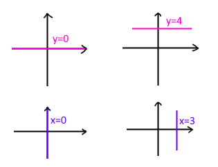
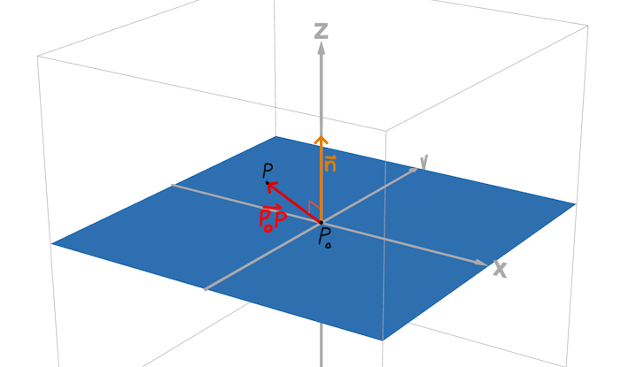

# Plan i rymden

## Agenda
1. Entry ticket
2. Några speciella plan
3. Ett godtyckligt plan
4. Punkt-normal form
5. Allmän form
6. Uppgifter
7. Exit ticket

## Entry ticket
> $$L_1(t)=\begin{cases}x=5+3t \\ y+5-\frac{1}{2}t=0 \\ 1-z=0\end{cases}$$
> $$L_2(t)=\begin{bmatrix}0\\2\\-\frac{1}{2}\end{bmatrix}t-\begin{bmatrix}1\\2\\0\end{bmatrix}$$
> $a) \quad \text{Vad är riktningsvektorerna }\vec{r_1} \text{ och } \vec{r_2}$
> $b) \quad \text{Skär linjerna varandra? Om ja, i vilken punkt?}$

## Några speciella plan
I 2D kommer vi ihåg att ekvationerna för x- och y-axeln är
$$\text{x-axeln: } \quad y=0 \\ \text{y-axeln: } \quad x=0$$
Vill vi flytta till exempel x-axeln upp fyra steg, så har den ekvationen $y=4$.

För att definiera plan kan vi göra likadant. Ekvationer för alla tre basic plan:
$$\text{zy-planet: } \quad x=0 \\ \text{xz-planet: } \quad y=0 \\ \text{xy-planet: } \quad z=0 $$

Vi kan flytta planen precis som för enkla linjer, t.ex. $y=4$ är:

> Uppgift:
> Ange ekvationen för det plan $\pi$ som
> 1. passerar genom punkten $P=(2,4,3)$
> 2. är parallell med xy-planet.
> $\text{Svar: }z=3$

## Det godtyckliga planet

Det smidigaste sättet att definiera ett plan är med dess normalvektor.

> Vad är en normalvektor? Kom ihåg från fysiken.

Om vi har ett plan med normalvektor $\vec{n}$ så vet vi att följande gäller:
- En **specifik** punkt där vi vill att planet ska utgå från är $P_0=(x_0,y_0,z_0)$
- En **godtycklig** punkt i planet är $P=(x,y,z)$
- Vektorn som leder från $P_0$ till $P$ skrivs enligt "slut-minus-start":
$$\vec{P_0P}=P-P_0=\begin{bmatrix}x-x_0 \\ y-y_0 \\ z-z_0\end{bmatrix}$$
- $\vec{n}$ och $\vec{P_0P}$ är **orthogonala**

Det betyder att förljande samband **måste** stämma för alla punkter i det godtyckliga planet:
$$\vec{n} \cdot \vec{P_0P}=0$$

$$\vec{n} \cdot \begin{bmatrix}x-x_0 \\ y-y_0 \\ z-z_0\end{bmatrix}=0$$

> Fråga:
> Fungerar det för typ yz-planet?
> Planets normalvektor är $(1,0,0)$, och en specifik punkt i planet är $(0,0,0)$:
> $$\vec{n} \cdot \begin{bmatrix}x-x_0 \\ y-y_0 \\ z-z_0\end{bmatrix}=\begin{bmatrix}1\\0\\0\end{bmatrix} \cdot \begin{bmatrix}x-0\\y-0\\z-0\end{bmatrix}=x=0$$

## Punkt-normal form
Låt oss ta ekvationen för det godtyckliga planet och skriv ut vad dene blir. Låt oss skriva normalvektorn som $\vec{n}=(A,B,C)$.
$$\vec{n} \cdot \begin{bmatrix}x-x_0 \\ y-y_0 \\ z-z_0\end{bmatrix}= \begin{bmatrix}A\\B\\C\end{bmatrix} \cdot \begin{bmatrix}x-x_0 \\ y-y_0 \\ z-z_0\end{bmatrix}=0$$

$$A(x-x_0)+B(y-y_0)+C(z-z_0)=0$$

## Allmän form

$$Ax-Ax_0+By-By_0+Cz-Cz_0=0$$

$$Ax+By+Cz-Ax_0-By_0-Cz_0=0$$

$$Ax+By+Cz+D=0$$

Den sista kallas för det godtyckliga planets ekvation på *allmän form*.

Notera att vi kan läsa av normalvektorn precis från koefficienterna till variablerna $x,y,z$.

> Exempel 1:
$$\pi: \quad x+5y-3z+17=0$$
> a) Vad är planets normalvektor?
> b) Ange ekvationen för ett annat unikt plan som är parallellt med planet $\pi$.
>
> *Vad gör D?*

> Exempel 2: 5319 i boken
> Vi har ett plan som innehåller tre punkter:
> $$\vec{P_1}=\begin{bmatrix}1\\1\\5\end{bmatrix} \quad \vec{P_2}=\begin{bmatrix}-2\\-4\\-4\end{bmatrix} \quad \vec{P_3}=\begin{bmatrix}3\\2\\4\end{bmatrix}$$
Bestäm ekvationen för planet.
> ***
> $\text{Lösning: }$
> $$\text{Punkt-normal form: } \\ A(x-x_0)+B(y-y_0)+C(z-z_0)=0$$
>
> Stoppar in första punkten som $P_0$.
>$$A(x-1)+B(y-1)+C(z-5)=0$$
> Vi stoppar in de två resterande punkterna och skapar ett ekvationssystem.
> $$\begin{cases}
A(-2-1)+B(-4-1)+C(-4-5)=0 \\
A(3-1)+B(2-1)+C(4-5)=0
\end{cases}$$
>
> Två ekvationer med tre okända. Vi kan inte få exakt en lösning här, men vi kan sätta $C$ som konstant och lösa ekvationssystemet med $A$ och $B$ som variabler.
>
> $$\begin{cases}
-3A-5B-9C=0 \\
2A+B-C=0
\end{cases} \begin{cases}
3A+5B+9C=0 \\
B=C-2A
\end{cases}$$
> $(2)$ i $(1)$ ger oss
> $$3A+5C-10A+9C=14C-7A=0 \\ A=2C$$
>
> Stoppa tillbaka in i $(2)$
>$$B=C-4C=-3C$$
>
> Sista vi gör nu är sätter $C$ till valfritt tal (förutom $0$ då det hade lett till en normalvektor $(0,0,0)$), säg $C=1$.
$$C=1 \Rightarrow A=2 \text{ och } B=-3$$
> 
> $\text{Svar:} \\
> \text{Planets ekvation är} \\
> 2(x-1)-3(y-1)+1(z-5)=0$

## Uppgifter
s.235

## Exit ticket