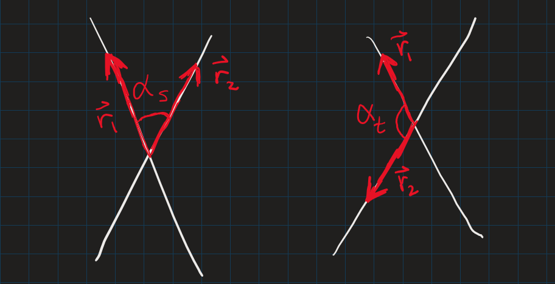
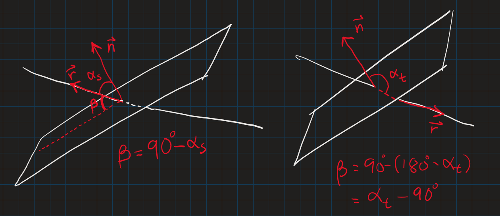
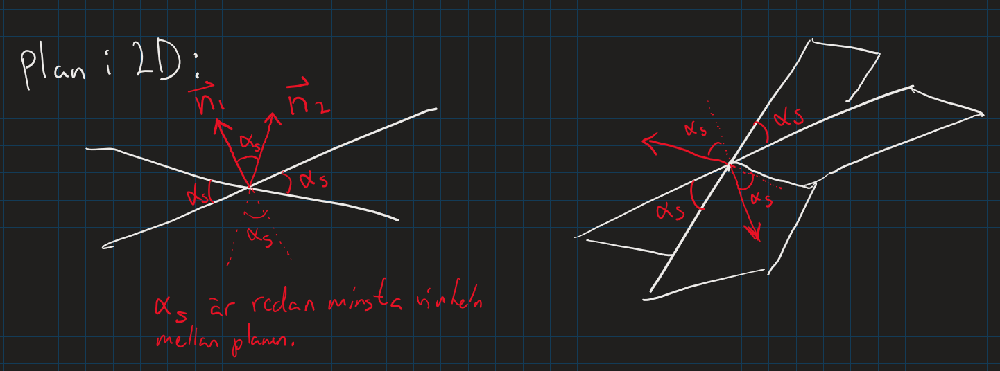
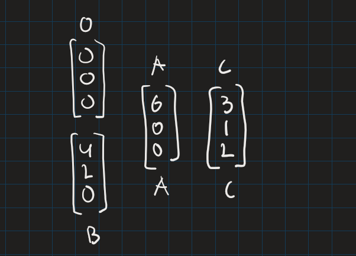
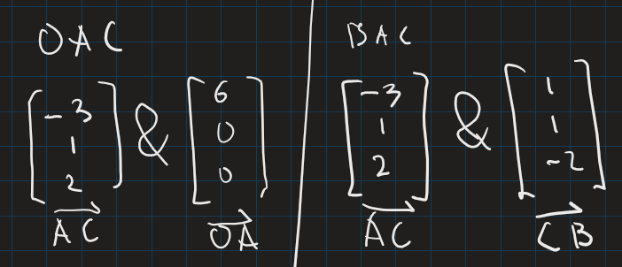
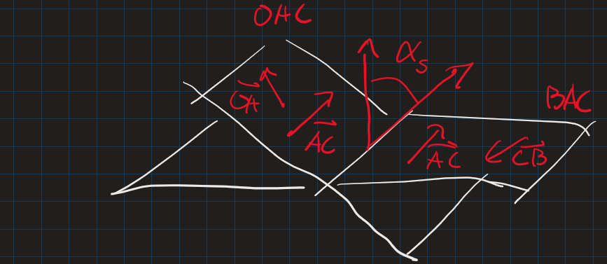
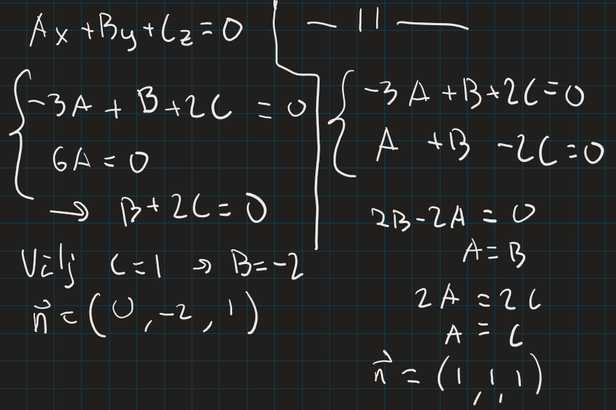

# Vinklar i rymden

## Agenda
1. Uppvärmning
2. Beräkna vinklar
3. Linje-linje
4. Plan-linje
5. Plan-plan
6. Räkna på uppgifter
7. Exit ticket

## Uppvärmning
Gårdagens exit ticket vi inte hann med:

> Ett plan $\pi$ går igenom punkterna $P_1=(0,0,8)$ och $P_2=(4,4,0)$. Bestäm $\pi : \pi \perp \psi$
>
> $\psi \text{ : } x+2y-z=0$
>
> $\text{Lösning:}$
> För att definiera ett plan behöver vi tre punkter. Annars kommer den inte ha låst rotation.
> $$\vec{n}_\psi=(1,2,-1) \text{ pekar parallellt längs }\pi$$
>
> Om vi adderar $\vec{n}_\psi$ på en existerande punkt i planet, säg $P_1$, så får vi en till som också existerar i planet.
$$P_3=P_1 + \vec{n}_\psi=\begin{bmatrix}0\\0\\8\end{bmatrix}+\begin{bmatrix}1\\2\\-1\end{bmatrix}=\begin{bmatrix}1\\2\\7\end{bmatrix}$$
Vi utgår från punkt-normal form, och väljer $P_1$ som vår punkt:
$$A(x-0)+B(y-0)+C(z-8)=0  \\ Ax+By+Cz=8C$$
> Vi stoppar in punkterna $P_2$ och $P_3$ och skapar ett ekvationssystem.
$$\begin{cases} 4A+4B+0C=8C \\
1A+2B+7C=8C\end{cases}$$
>
>$$\begin{cases} A+B=2C \\
A+2B=C\end{cases}$$
>
> $$A=3C \quad \quad B=-C$$
>
> Väljer vi $C=1$ får vi planets normalvektor till
>
>$$\vec{n}_\psi=\begin{bmatrix}A\\B\\C\end{bmatrix}=\begin{bmatrix}3\\-1\\1\end{bmatrix}$$
>
> $\text{Svar:}$ Planets ekvation blir $\pi \text{ : } 3x-y+z=8$
>
> Är planen orthogonala?
> $$\vec{n}_\psi \cdot \vec{n}_\pi=\begin{bmatrix}1\\2\\-1\end{bmatrix} \cdot \begin{bmatrix}3\\-1\\1\end{bmatrix}=1\cdot3+2\cdot(-1)+(-1)\cdot 1=3-2-1=0$$

## Beräkna vinklar
Formeln för skalärprodukt $\vec{u} \cdot \vec{v} = |\vec{u}| |\vec{v}| \cos\alpha$ ger oss ett sätt att beräkna vinkeln:
$$\cos\alpha=\frac{\vec{u} \cdot \vec{v}}{|\vec{u}| |\vec{v}|} \quad \quad 0^\circ \le \alpha \le 180^\circ$$

### Linje-linje
När vi mäter vinkel mellan två linjer kan vi egentligen få två vinklar, beroende på riktningsvektorerna.

Vi svarar oftast med den spetsiga vinkeln. Om vi får den trubbiga vinkeln då? Då gör vi helt enkelt
$$\alpha_{s}=180^\circ-\alpha_{t}$$

Varför är det så viktigt med den spetsiga vinkeln? Vi behöver den för följande vinkelberäkningar.

### Linje-plan
Vinkeln mellan linje och plan är den vinkel mellan linje och linjens *projektion* på planet. Vi utgår från den spetsiga vinkeln $\alpha_s$. Vi vet att den sökta vinkeln $\beta$ och $\alpha_s$ tillsammans bildar $90^\circ$. 
$$\beta=90^\circ-\alpha_s$$

### Plan-plan
Här hjälper det mycket att tänka i sidovy.

Det räcker faktiskt att ta fram $\alpha_s$. Går att visa med räta vinklar och vertikalvinklar.

## Uppgifter
s.238 Vinklar mellan vektorer
s.239 Linje-linje
s.241 Plan-plan, linje-plan

## Exit ticket
> Fyra punkter $O$, $B$, $A$, $C$:
> 
>
> Vad är vinkeln mellan planet $OAC$ och $BAC$?

Vad betyder vinkeln mellan planen? Jo, det är ju samma som vinkeln mellan planens normalvektorer.

För detta behöver vi inte göra en helt fullständig uträkning eftersom vi inte behöver veta exakt vart planet ligger, endast vad dess normalvektor är. Vi kan då använda en reducerad vertion av den allmänna formen:

$$\vec{n} \cdot \vec{v} = Ax+By+Cz=0$$

där $\vec{v}$ är en vektor som finns i planet. Först konstruerar vi två vektorer per plan. Som tur är delar de en vektor:

Det är väldigt svårt att rita den här situationen exakt, men man kan rita upp ett generellt fall som liknar vårat, med våra beteckningar:

Vi behöver konstruera två ekvationssystem, ett per plan:

Vi får då
$$\cos\alpha = \frac{\vec{u} \cdot \vec{v}}{|\vec{u}| |\vec{v}|} = \frac{-1}{\sqrt3 \sqrt5}=-\frac{1}{\sqrt{15}}$$
$$\alpha_t\approx105^\circ \Rightarrow \alpha_s=180^\circ-105^\circ=75^\circ$$