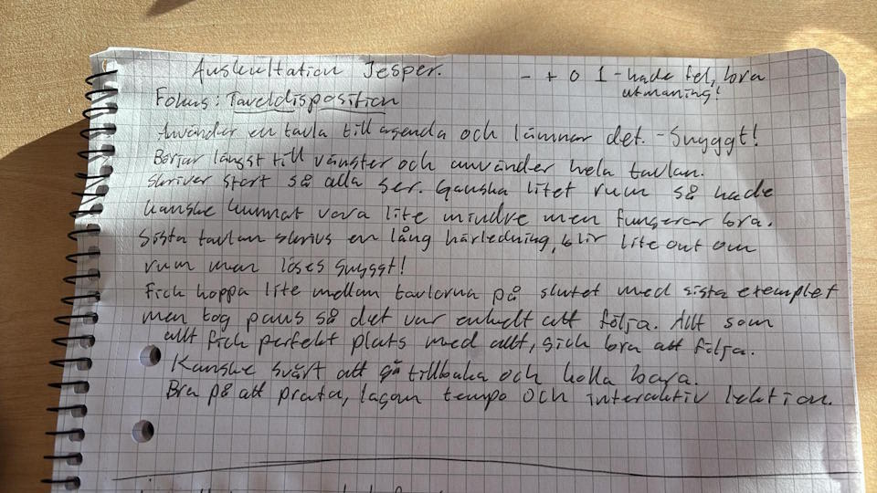

# Loggbok V45
#### Tid på skolan
| Dag | Start | Slut | Tid (min) |
|-----|-------|------|-----------|
|Mån|8:00|10:00|120|
|Ons|8:30|15:20|410|
|Tor|7:40|16:00|500|
|Fre|8:30|15:00|390|

#### Auskultationer
| Dag | Kurs | Område | Lärare | Tid (min)|
|-----|------|--------|--------|-----|
|Ons (besöksdag)|Ma1c|Definitions- och värdemängd|HJ|90|
|Ons (besöksdag)|MaS|Vektorer|HJ|90|
|Ons|Ma1c|Prov Kap 2 & 3|HJ|90|
|Tors|AI n1|EoAI|HJ|90|
|Tors|MaF1|$e^{kx}$|VFU AH|80|
||||||

#### Egna lektioner
| Dag | Kurs | Område | Tid (min) |
|-----|------|--------|-----|
|Ons|MaSpec|Skalärprodukt|90|
|Tors|Ma1c|Tangens|90|
|Tors|MaSpec|Vektorer i 3D|90|
|Fre|Ma1c|Sinus & Cosinus + Enhetscirkeln|90|
||||| 

### Förkommentar
Jag är mest nervös att kunna skapa bra studiemiljö och inspirera respekt. Idag (02/11) blev jag inspirerad när vi pratade med tvåorna: att den första kvarten på eget arbete ska vara helt tyst. Känns som en bra kompromiss mellan stökigt och knäpptyst hela lektionen. Varför inte tyst hela lektionen? Jag vill uppmuntra matematisk diskussion!

## Reflektioner
### Auskultationer

#### AU 261014 Onsdag besöksdagen Ma1c
Det första jag noterade var att eleverna hade aluminiumburkar. Jag hade begränsat till flaskor som kan stängas. När läraren gick ut för att hämta en mattebok så spillde en elev dricka på backen och fick gå och städa upp det. Någons block kunde blivit dränkt, eller i värsta fall så kunde en dator gått sönder.

Inget teknikförbud upprätthålls. Vill jag göra det på mina lektioner? Ja, men vet inte om det är rätt att *samla in* telefonerna.

Läraren kopplade ämnet (egentligen repetitionen) till fysik, vilket jag tänker kommunicerar ämnets relevans för nästa termin.

Ingen tar anteckningar. Det blir svårare för eleven att *lära sig* och *repetera*. Dock vet jag inte om jag vill tvinga.

Ibland gör vi lite annorlunda från boken, så viktiga processer och metoder är användbart att skriva ner!

Läraren hade ingen uppenbar lektionsplanering. Ibland kan erfarenhet vara tillräckligt, men jag bör ha en planering för att säga till så jag fånga min *avsikt* i min undervisning.

Högljutt under arbetsstunden efter genomgången, men de flesta kämpar på. Läraren säger till flera gånger, men inte utöver något ovanligt.

När läraren börjar gå igenom defmängd så förenklar han med först tallinje för att sedan visa i koordinatsystemet som en begränsning. Det är viktigt att börja från en referenspunkt eleven redan känner till.

I slutet fick eleverna ett "överaskningsprov" på innehåll från tidigare lektioner. Trots att läraren betonar att det är för elevernas skull och det inte är betygsgrundande, så blir det helt knäpptyst. Många elever verkade inse att de inte hade så mycket koll som de trodde. Jag har aldrig tänkt på det själv, men det är ett spännande sätt att göra en avstämning på.

Mitt helhetsintryck var att lektionen kändes för det mesta "traditionell": genomgång -> eget arbete. Det som verkligen stack ut var överaskningsrovet!

#### AU 261014 Onsdag besöksdagen MaS
Liksom lektionen innan kommuniceras inget mål med lektionen. Men läraren är väldigt bekväm och trygg vid tavlan vilket jag tänker borde ge trygghet för eleverna.

Genomgången var översiktlig och det handlade mest om att repetera räkneregler för vektorer. Något jag tolkade som nytt var tanken att bilda en vektor genom att ta "slutpunkt minus startpunkt".

Formatet var som innan: genomgång -> eget arbete. Trots att det är det traditionella sättet så tilltalar det mig mest, bara att man breddar genomgången på ett sätt som enkluderar EPA, mycket hands on (montessori & bruners enactive), och 5E.

#### AU 261104 Onsdag Ma1c
Prov. Två elever var borta, och salen var ändå smockfull: det var fler bord än plats i rummet. Inte bästa provsalen.

Jag noterade att handledaren fortfarande använder E/C/A-poäng på provet, vilket man inte bör göra längre. Jag kan se både fördelar och nackdelar med båda systemen.

Jag frågade om det fanns bedömningsanvisningar, men vid bedömning så "höftar" han. Kan funka med djup erfarenhet inom yrket, men riskerar att bedömning inte blir jämlik.

När handledaren svarade på frågor under provet kändes han väldigt snäll. Ett exempel där uppgiften var att bestämma linjens ekvation från två kända punkter:
> du får ut m genom att beräkna k, och lägga in en punkt i formeln"

Detta får mig att tänka på en filosofi som jag gillat, men som självklart har sina problem: att se varje prov som en möjlighet för eleven att lära sig. På ett sätt speglades det hos handledaren när han sa att det första betyget i första ämnet inte spelar roll. Vad han å andra sidan menade var att man kan vara hur elak som helst i sin bedömning.

#### AU 261105 Torsdag AI HJ
**Fokus:** uppstart och generella intryck.
HJ noterade att det saknades lite inlämningar, så HJ hade repetition av "classroom" för att säga till så att inget glöms.

Som del av kursen kör HJ LIU-kurs "Elements of AI" (EoAI). Ger eleverna möjlighet att samla på sig 2 HP efter gymnasiet. På Antagning.se efter trean kan de sedan ansöka till kursen, och man kommer alltid in. De kan sedan göra ett "Valideringstest" och få sina HP och ett certifikat.

Använder sig av AI-genererad presentation, baserat på innehållet från EoAI. På ett sätt lat, men det passar tematiskt!

Denna lektionen var väldigt annorlunda ämne från matematiken, bland annat då denna lektion för det mesta skulle vara arbetsstund.

#### AU 261105 Torsdag Ma hos VFU AH
Klassen applåderar! Mysigt! Även jag fick en applåd! Jisses!

Eleverna har haft prov och är trötta. AH gör en kompromiss att kanske kunna sluta lite tidigare. Skönt och ==mänskligt==!

Efter lite försnack, ==inleder med repetition== från lektionen innan. Mycket bra! Kanske även bör lägga till någon repetition från tidigare, för att fånga ÄNNU mer kunskap?

> Svårt att se projektorn tydligt med ljuset i salen. Tror inte de längst bort i salen kan se bra nog.

Bra och mycket frågor från eleverna!

Kombinerar projektor och tavlan.

> Formatet på matematiska uttryck på projektorn kanske blir lite förvirrande
> $$f'(x)=2^x\cdot \frac{lim}{h\rightarrow 0} \frac{2^h-1}{h}$$
> Lite olagligt att ha en division där limes står? Förslag: använd desmos? LaTeX? Markdown? Hur går det med presentationer?

==AH är bekväm== hela tiden. Om grabben är nervös så märks det inte av alls. Lektionen ser genomtänkt ut, och att det finns erfarenet bakom den.

Jag är imponerad av att han redan inspirerat ett ==öppet klassrumsklimat== där elever öppet vågar svara på frågor och även säger när något gick för fort/var för svårt/för otydligt.

Alla kommer inte kunna hänga med på derivatans definition, så det är snyggt att AH ==sammanfattar== *det som är absolut viktigast att ta med sig*.

Exempel på tavlan. AH kör en variant av EPA, där man själv kan välja E eller P. Sedan helklass. Funkar bra, i alla delar.

> "Mål" med lektionen saknas. Kanske inte är så nödvändigt för genomgång av en deriveringsregel.

När eleverna inte räcker upp handen, så går han runt. ==Uppmärksammar även de som kanske inte vågar fråga efter hjälp==.

### Egen undervisning

#### EU 261104 Onsdag MaSpec
På lektionen räknade jag med två vektorer och gav namn på deras koordinater:
$$2|\vec{u}||\vec{v}|\cos(\alpha)= x_u^2+y_u^2 + x_v^2+y_v^2 - (x_v^2 - 2x_vx_u + x_u^2)-(y_v^2-2y_vy_u+y_u^2)$$
Jag tyckte det blev mycket att hålla koll på, och då tog jag för givet att eleverna tyckte detsamma. Å andra sidan sa handledaren att det inte såg otydligt ut. Ändringar inför nästa gång:
1. istället för $u$ och $v$ som subskript (väldigt lika bokstäver) kan använda vektorer $\vec{a}$ och $\vec{b}$ istället. Tänkter att $x_a$ och $x_b$ är bättre.
2. eller så byter jag ut komponenterna till bokstäverna: $x_u = a$, $x_v = c$. Då blir hela uträkningen tydligare, även fast det kanske är svårare att se vilken vektor som har vilka komponenter.

Beröm jag fick från handledaren:
> Jag var närvarande, kändes bekväm på "scen". Har kvalitéer som gör mig till en naturlig lärare, åtminstone på just genomgången.

En sak han kom på var att bra att fokusera på "relationellt" lärande vilket han illustrerar som att **involvera elevers intressen i undervisningen**. Det ska jag försöka få in, och det blir desto lättare när jag känt eleverna längre. 

En annan sak han betonade var att **involvera eleverna genom att ställa frågor till klassen**. Det håller uppmärksamheten uppe då de behöver vara redo på att svara på frågor. Jag tog detta ett steg längre och föreslog att **ställa frågor till specifika elever som verkar distraherade**, vilket han tyckte var en bra idé. Men först måste jag lära mig namnen.

**Försiktig med vad jag "höftar" på tavlan**. Jag borde skrivit "svaren" på EPA:n på tavlan när vi gick igenom i helklass. Jag gjorde det för en av fyra bilder, och ett förtydligande vilket ironiskt nog gjorde det rörigare. Jag missade E på EPA:n, men jag tyckte inte det gjorde så mycket skillnad då det är diskussionerna jag värderar mest.

(Tipsade om att introducera enhetscirkeln inför en senare lektion på trigonometri, trots att det egentligen inte dyker upp förrän matte fortsättning 2)

En VFU-student auskulterade:

Jag ska tänka på storleken på tavlan. Jag hade nätt och jämnt tillräckligt med plats, och då hoppade jag lite mellan tavlorna i slutet. Kanske blir min agenda för stor och tar för mycket plats?

#### EU 261105 Torsdag Ma1c Tangens
Testade ett strikt 5E-upplägg, med egen räkning innan Evaluate.

Introducerade ämnet med en enkel uppgift där de däremot saknade verktyg för att lösa. Jag måste vara tydligare om det är *enskilt* eller *diskutera i grupp*.

En elev var en kombiation av understimulerad och lat och valde att spela istället för att delta på lektionen. Handledare hjälpte mig lösa problemet genom att sätta sig enskilt med eleven och gå igenom svårare saker. ==Kanske ha med mig en Matte 3c/MaF1c-bok nästa gång?==

Handledare tyckte det gick väldigt bra. Efter att ha sett mina datorskrivna anteckningar tycker han att jag skulle kunna använda dem som en repetition av föregående lektion. Bra även för de som missade den, sen kunna ge mer enskild undervisning på arbetsstunden för de som varit frånvarande.

Jag glömde min Exit ticket, men handledare föreslog att den tar jag som introduktion på nästa tillfälle. Bra notering att komma ihåg att man kan ta  5E i valfri ordning. 

Handledare föreslog att jag skulle testa hålla i lektionen när han inte är där (bara uppstart, då vi inte får ta närvaro), för att känna på om jag har kontroll på klassen, så att säga. Handledare är övertygad att båda klasserna accepterar mig.

#### EU 261105 Torsdag MaSpec Vektorer i rymden
Inledde med repetition. Kändes *lite* bökigt att använda mina egna anteckningar, men å andra sidan upplevde jag det som användbart då jag har med många figurer som kan ta lång tid att rita tavlan.

Jag kom ihåg min exit ticket och det var ett effektivt sätt att väva samman lite begrepp.

#### EU 261106 Fredag Ma1c
Fortsättning på trigonometri från förra gången. Genomgången var väldigt kort med utökning till sinus och cosinus. Fick problem med en elev som vägrade börja arbeta och bara ville spela. Behövde ge ett ultimatum att ser jag spel på datorn en gång till så kommer jag ta datorn (tidigare lektioner gav jag många möjligheter till skärpning, se onsdagens reflektion). Handledaren var lite mer diplomatisk och satte sig enskilt med eleven. **Idag fungerade det, men vad gör man när man är ensam lärare och behöver hjälpa andra?**

###### 💡 Reflektionsmall egen lektion
*➕ Beskriv det som var **positivt**, bra, konstruktivt med din lektion och ditt lektionsupplägg eller i den situation som har inträffat.*

*➖ Beskriv det som inte gick bra eller var **negativt**, kritiskt eller ogynnsamt på lektionen eller lektionsupplägget.*

*❗ Beskriv om du fick någon **ny insikt** eller aha-upplevelse under den aktuella situationen.*

*❓ Väcktes några frågor, **funderingar**, ovisshet eller tvivel under lektionen eller situationen.*

*📊 Vad blev resultatet, konsekvenserna eller **utfallet** av lektionen?*

*👣 Vilka **framtida förändringar** vill du göra? Hur vill du utveckla undervisningen eller lektionsplanen till nästa gång? Hur kan du hantera en liknande situation nästa gång?*